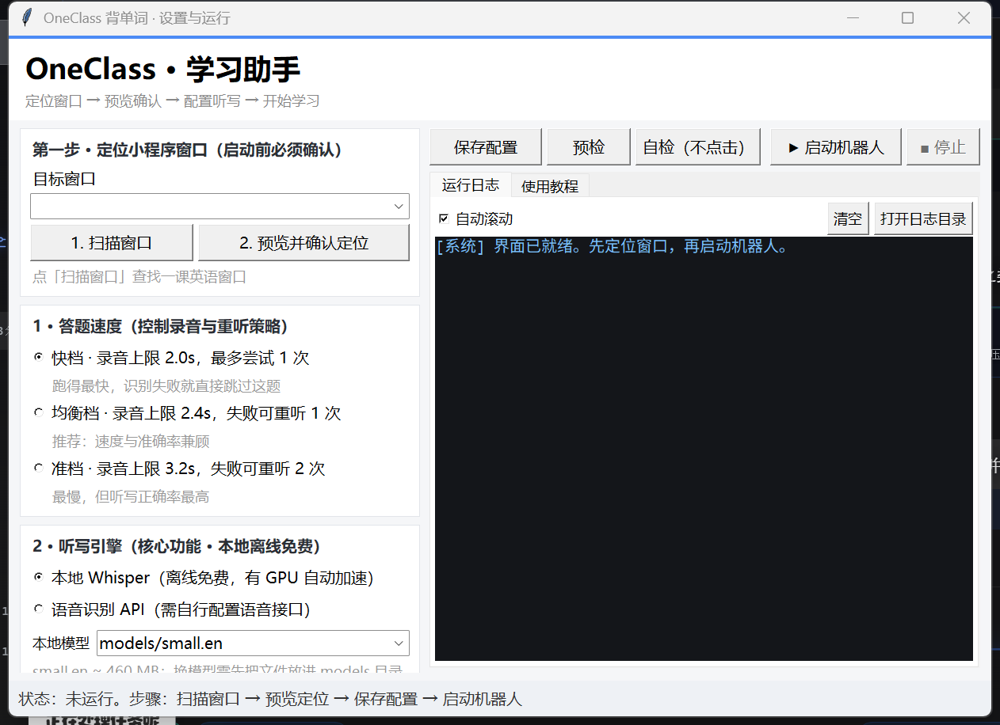

# 使用说明 · 图形界面版

> 适用于 `一课英语助手` 完整版 / 轻量版。命令行版见文末。

## 界面总览



左边四张卡片是设置，右边是操作按钮和运行日志，底部状态栏实时显示机器人当前在做什么。

---

## 〇、准备（只做一次）

双击 **`启动界面.cmd`**，打开「OneClass · 学习助手」。

> 想用纯命令行版就双击 `启动.cmd`，两者等价；图形版能看日志、能改设置。

---

## 一、打开小程序并定位

1. 打开电脑版微信 → 进入「一课英语」小程序；
2. 把小程序窗口拖到**固定位置**，白色内容区完整露出，不要最小化、不要被别的窗口压住；
3. 回到助手窗口，点 **`1. 扫描窗口`**；
4. 下拉框选中微信/一课英语那个窗口（显示为 `微信 [x,y 宽x高]`，最小化的会标注「选它会自动还原」）；
5. 点 **`2. 预览并确认定位`** → 确认弹窗点「是」；
6. 弹出缩略预览图，检查是否只有小程序内容：

| 预览图 | 判断 |
|---|---|
| 整张都是小程序内容（标题「背单词」+ 白色区域） | ✅ 正确 |
| 能看到桌面背景、别的窗口、只有半截 | ❌ 重新扫描，或双击 `calibrate.cmd` 手动框选 |

预览没问题就关掉，**定位已自动写入** `config.yaml` 的 `region`。

---

## 二、选设置 → 保存

| 项目 | 建议 |
|---|---|
| 答题速度 | 新手选 **均衡档**（录音 2.4s，失败重听 1 次） |
| 听写引擎 | 保持 **本地 Whisper**，模型 `models/small.en` |

点右上角 **`保存配置`**。底部状态栏显示「配置已保存（录音 2.4s，重听 1 次）」。

三档速度对应的配置：

| 档位 | `audio_record_seconds` | `dictation_max_attempts` |
|---|---|---|
| 快档 | 2.0 | 1 |
| 均衡档 | 2.4 | 2 |
| 准档 | 3.2 | 3 |

---

## 三、预检 + 自检

**`预检`**（不启动，只检查）：

- `region` 是否有效、是否横向（横向说明框歪了）
- `models/<模型>/model.bin` 是否存在且完整（> 100 MB）
- 当前 Python 是否 3.13（依赖按 3.13 编译）
- pyyaml / opencv / mss / pyautogui / rapidocr / onnxruntime 是否能导入

全绿会提示「一切正常，可以启动机器人」；有问题会列出来，日志里是黄色。

**`自检（不点击）`**：跑 `checkup.py`，只截图 + OCR，不点任何东西。日志里会出现：

```
OCR 识别到 N 段文字：…
页面状态：learn_hidden / word_home / test_choice / unknown
```

看到 `learn_hidden` 或 `word_home` 说明定位正确；一直是 `unknown` 就回去重新定位。

---

## 四、启动

点 **`▶ 启动机器人`**（或按 `F5`）。

- `▶ 启动机器人` 变灰、`■ 停止` 变亮，右上显示「运行中」；
- 「运行日志」开始滚动：

```
[系统] 已启动：python -u …\main.py
页面状态：word_home | OCR=…
点击文字 开始背诵 at (…)
页面状态：learn_hidden | OCR=背单词|…|salary|英:[…]
已记录词义：salary -> n. 工资，薪水
点击文字 标记为太简单 at (499, 234)
页面状态：test_choice | OCR=…|请选择正确的释义|…
最佳选项：n. 工资，薪水，匹配分 100.0
```

底部状态栏实时显示「运行中 · 当前页面 learn_revealed」「运行中 · 本次正确率 84.0%」。

---

## 五、停止

| 方式 | 说明 |
|---|---|
| 点 `■ 停止` | 结束机器人（含子进程） |
| 关掉助手窗口 | 会先自动停机器人 |
| 命令行版 `Ctrl+C` | 或鼠标甩到屏幕左上角（应急停止） |

---

## 六、每天的固定流程

1. 微信里进入「一课英语」小程序，停在背单词首页；
2. 双击 `启动界面.cmd`；
3. 窗口没动过的话：直接 `预检` → `▶ 启动机器人`（定位只做一次）；
4. 让它跑，留意日志有没有红色；
5. 跑完点 `■ 停止`。

---

## 七、出问题时对照日志

| 日志里出现 | 含义 | 处理 |
|---|---|---|
| `页面状态：unknown` 连续出现 | 区域没框对 | 重新「扫描窗口 → 预览确认定位」 |
| `点空白后页面没反应，先把窗口置前…` | 点击没生效，正在自动补救 | 把命令行窗口挪开，别压住小程序 |
| `已把窗口置前 → …` | 补救成功 | 正常 |
| `录到的音频是静音` | 输出设备名不对 | 改 `config.yaml` 的 `audio_loopback_name` |
| `词库缺词，暂停 12 秒` | 没背过的单词 | 等它自动跳过，或改 `unknown_choice_strategy: unknown` |
| `画面已经 N 秒没有变化` | 页面卡住 / 被遮挡 | 点「自检」看截图 |
| 红色 `ERROR` 很多 | 依赖或模型问题 | 点「预检」看缺什么 |
| `OCR 未找到确定按钮，使用 dictation_confirm 兜底坐标` | 听写页按钮没认到 | 一般仍能提交；频繁出现就重新定位 |

---

## 八、两条硬性约束

1. **运行期间不要移动小程序窗口、不要改 Windows 缩放** —— 坐标全部错位；
2. **不要中途关掉小程序** —— 它自己写着「背诵/考试中途退出不保存记录」，那一组白做。

---

## 九、命令行版（等价）

```
启动.cmd        直接跑 main.py，看命令行输出
calibrate.cmd   手动框选区域（点左上角、右下角各回车一次）
checkup.cmd     只截图 + 识别，不点击
```

配置文件是 `config.yaml`，常用项：

```yaml
region:                  # 识别区域，图形界面里点「预览并确认定位」会改这里
audio_record_seconds:    # 录音时长上限
dictation_max_attempts:  # 听写最多尝试次数
whisper_model: models/small.en
audio_loopback_name: 扬声器 (Realtek(R) Audio)   # 改成你机器的设备名
```

看有哪些音频设备：双击 `list_audio_devices.py`，或命令行跑 `python list_audio_devices.py`。

---

原项目：<https://github.com/zhouwu97/oneclass>（作者 zhouwu97）
